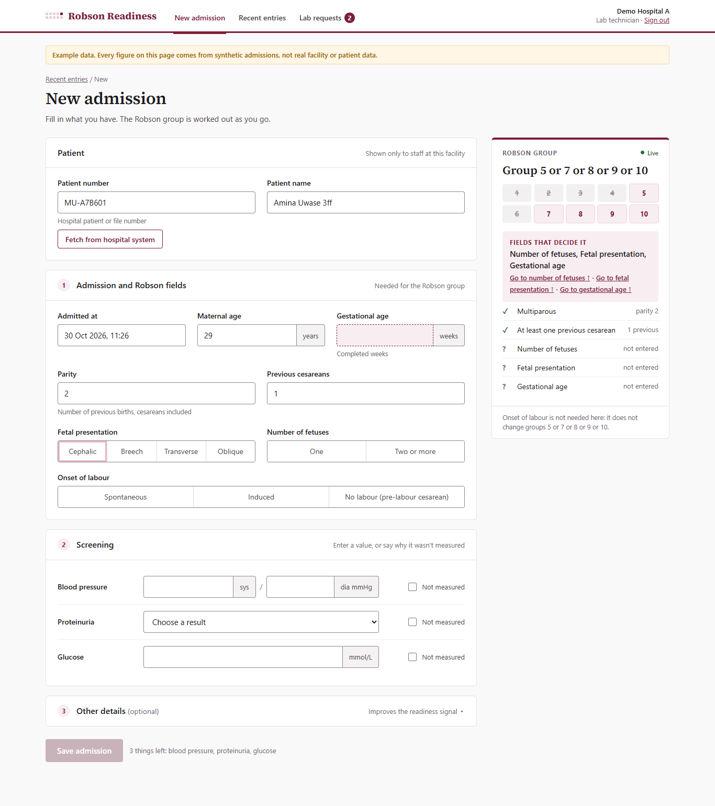
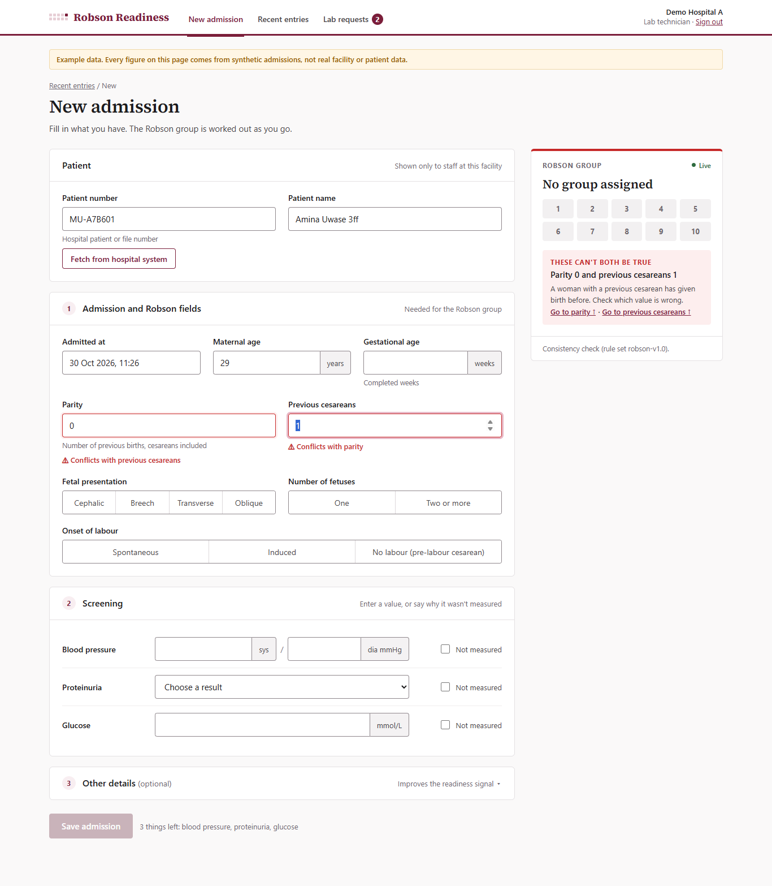
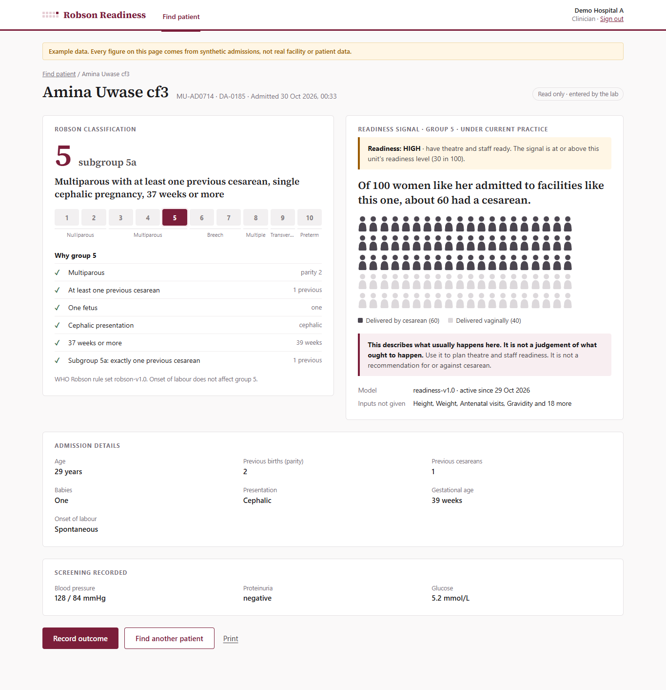
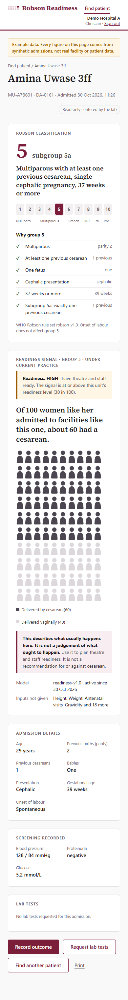
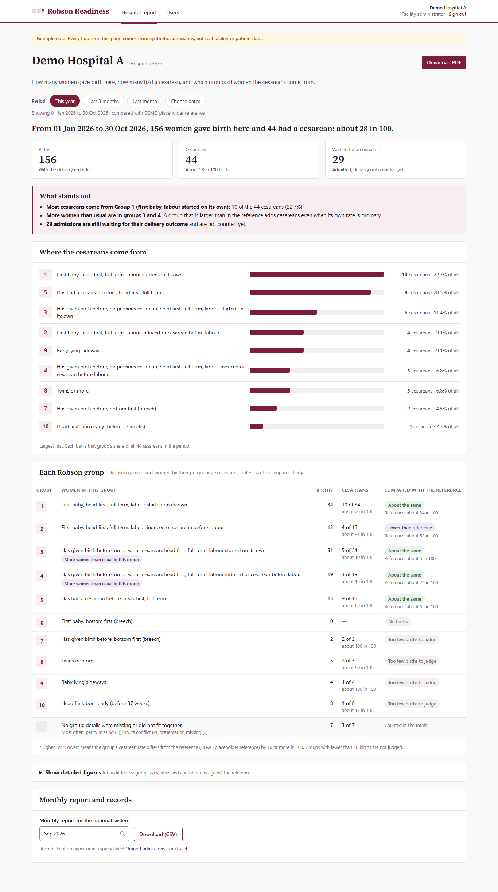
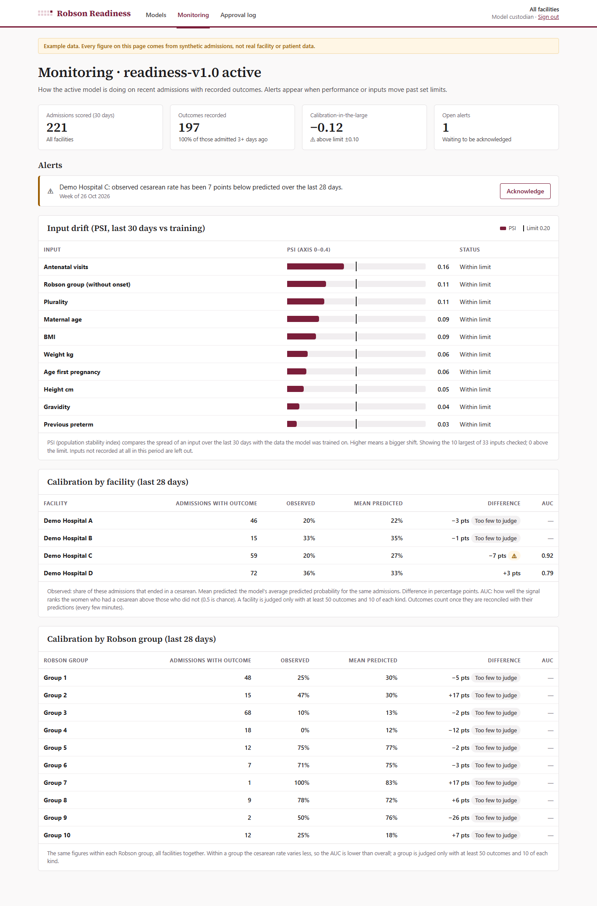

# Robson Readiness

**Automated Robson Ten-Group classification and cesarean readiness system for Rwandan maternity units**

| | |
|---|---|
| Live demonstration | <https://robby.example.org>: synthetic data, accounts under [Try it](#try-it) |
| Walkthrough video | *link to be added* |
| Technical report (PDF) | *link to be added* |
| Repository | <https://github.com/icyeza/robby> |

## Overview

At admission to a maternity ward, the system does six things:

1. **Classifies** the woman into one of the WHO Robson Ten Groups from six admission fields: parity,
   previous cesareans, number of fetuses, presentation, gestational age and onset of labour.
   - The group is shown live while the form is filled in.
   - When fields are missing, it lists the groups still possible and the field that would decide.
   - When fields contradict each other, it names them.
   - Every result shows the rules that were checked.
2. **Enforces screening**: blood pressure, proteinuria and glucose must each have a value or a
   recorded reason for not being measured, before anything is saved.
3. **Estimates readiness**: a calibrated probability that the birth ends in a cesarean *under current
   practice*. It is an operational signal for planning theatre and staff, never a recommendation for
   or against a cesarean.
4. **Lab requests**: a clinician can ask the lab for a urine protein, blood glucose or HIV rapid
   test, marked urgent if needed. The lab technician sees the waiting requests (a count in the
   navigation) and records the results. An HIV result re-scores the readiness signal, because HIV
   status is one of the model's inputs. The earlier signal is kept, so every past signal can still
   be reproduced. Results are encrypted at rest.
5. **Closes the loop**: the clinician records the mode of delivery, and every prediction is joined
   to its outcome. The model custodian then sees discrimination, calibration and input drift per
   facility and per Robson group. A new model goes from *candidate* to *shadow* to *active*, and
   each step needs a named approver and a reason.
6. **Audits facilities**: each hospital gets a Robson report with group sizes, cesarean rates and
   each group's contribution, compared with a reference population. The report also comes as a PDF,
   and a monthly CSV export goes to the national system. The national reviewer sees aggregates
   across hospitals.
7. **Connects to the hospital record system** through FHIR R4, which is the international standard
   for exchanging health records. The hospital system can push admissions to the app as FHIR
   Bundles, or the form can fetch a patient's admission by patient number. If the record system is
   unreachable, the form says so and works by hand. Admissions can also come from Excel (facility
   administrator) or a token-authenticated JSON API. Every route goes through the same checks as
   the form.

### Roles

| Role | Does | Patient data visible |
|---|---|---|
| Lab technician | Enters admissions on the form; answers clinicians' lab requests | Name and number, own facility |
| Clinician | Finds a patient, reads the classification and readiness signal, requests lab tests, records the outcome | Name and number, own facility |
| Facility administrator | Hospital report, PDF, monthly export, Excel import, facility users | Patient number only, own facility |
| National reviewer | National overview across facilities | Aggregates only |
| Model custodian | Model registry and promotion, monitoring, approval log | None |
| System administrator | Facilities and users | None |

### Results

The model was trained on 5,520 de-identified delivery records from four hospitals in and around
Kigali (Muhima, Masaka, Kibagabaga and La Croix du Sud), covering November 2023 to March 2024. The
records were shared under a data-sharing agreement and are **not** in this repository.

| | |
|---|---|
| Robson classification | 94.4% of records resolve to exactly one group; no record is contradictory |
| Selected model | L2 logistic regression (feature set FS2, iterative imputation), chosen by a rule committed before training |
| Discrimination on an unseen hospital | mean AUC **0.752** (0.71–0.82 across the four hospitals); the Robson-group lookup alone reaches 0.730 |
| Calibration | slope **0.99** (target 0.8–1.2) |
| Later time period | AUC 0.772 (Robson lookup: 0.725) |
| Model families compared | 8, from a single decision tree to an FT-Transformer, all between 0.71 and 0.75 AUC |

## Try it

The live demonstration runs on synthetic admissions only, with a banner on every page saying so.
Four demo hospitals each have their own accounts (`da` to `dd`), and the password for every account
is `demo-password-123`.

| Sign in as | To see |
|---|---|
| `lab.da` | The admission form (the live Robson group, partial and conflict states, blocked screening, fetch from the hospital system with `FX-2001`), and the lab requests waiting |
| `clinician.da` | Find a patient, the result page with the readiness signal, request lab tests, record an outcome |
| `admin.da` | The hospital report, the PDF, the monthly export and Excel import |
| `reviewer` | The national overview |
| `custodian` | Models, promotion, the approval log and monitoring |
| `sysadmin` | Facilities and users |

## Technical requirements

| | Version | Used for |
|---|---|---|
| Python | 3.11 (installed by uv; the shared packages also pass on 3.12 and 3.13) | Everything |
| [uv](https://docs.astral.sh/uv/) | 0.8 or later | Environments; every dependency is pinned in `uv.lock` |
| PostgreSQL | 16 | The web application's database |
| FastAPI / Uvicorn | 0.143 / 0.54 | Web application and the ML API |
| SQLAlchemy / Alembic / psycopg | 2.1 / 1.20 / 3.3 | Database access and migrations |
| Jinja2 + htmx | 3.1 + 2.0.4 (vendored) | Server-rendered pages; the live Robson panel |
| scikit-learn / pandas / NumPy | 1.9 / 2.3 / 2.4 | Model and features (shared by training and serving) |
| XGBoost / PyTorch / statsmodels | 3.2 / 2.14 / 0.15 | Training and comparison only (`ML/`); never installed with the app |
| MLflow / Optuna / SHAP | 3.16 / 5.0 / 0.51 | Experiment tracking, tuning, explanations (`ML/`) |
| argon2-cffi, cryptography | 25.1, 50.0 | Password hashing; AES-256-GCM encryption of patient identifiers |
| openpyxl, ReportLab, httpx2 | 3.1, 5.1, 2.13 | Excel import, PDF reports, FHIR client |
| age | 1.1 (server) | Encrypting database backups |
| Playwright, Locust, axe-core, pip-audit | via `uv run --with …` / `uvx` | Cross-browser, screenshot, stress, accessibility and dependency checks (optional) |

**Operating systems:** developed on Windows 11, and deployed and tested on Ubuntu 24.04.

**Hardware:** the server needs at least one CPU core and 1 GB of RAM for the application, plus
PostgreSQL. With half a core, saving an admission goes over the 500 ms target; see
[Performance](#performance-and-resources). Clients need only a current browser. The pages work at
phone width.

## Setup

Prerequisites: [Git](https://git-scm.com/) and [uv](https://docs.astral.sh/uv/getting-started/installation/).
The web application also needs PostgreSQL 16.

**ML workspace** (notebooks, training code, tests, API):

```bash
git clone https://github.com/icyeza/robby.git
cd robby/ML
uv sync                       # creates .venv with every dependency pinned in uv.lock
uv run pytest                 # test suite (runs on synthetic data)
uv run uvicorn api.main:app   # API with Swagger UI at http://127.0.0.1:8000/docs
```

Endpoints: `GET /health`, `GET /model`, `POST /classify` (Robson group with explanation), and
`POST /admissions/assess` (screening check, Robson group and readiness probability).

- **Model.** The API loads the packaged model committed in
  `ML/artefacts/packaged/readiness-v1.0/`. It contains coefficients, the feature schema, training
  marginal distributions with no bucket under 10 people, and synthetic golden test cases; it holds
  no patient record. The API checks the model against the hash in its manifest.
- **Notebooks.** Open `ML/notebooks/*.ipynb` in Jupyter (`uv run jupyter lab notebooks/`). The
  committed copies contain the outputs from the real data. Without the private dataset, re-running
  them uses synthetic data automatically.

**Web application.** Full instructions for Windows and Linux, the settings, demo mode and the tests
are in [`app/README.md`](app/README.md). In short:

```bash
cd robby/app
cp .env.example .env          # set ROBBY_DATABASE_URL, ROBBY_SECRET_KEY, ROBBY_SECURE_COOKIES=false
uv sync
uv run robby-admin db upgrade
uv run robby-admin rules load
uv run robby-admin create-system-admin --username admin
uv run uvicorn robby.main:create_app --factory --reload   # http://127.0.0.1:8000
```

For the same example data as the live demonstration, run `uv run robby-admin demo load` and then
`sh scripts/demo.sh` (http://127.0.0.1:8100).

## Deployment

The live demonstration runs on an Ubuntu 24.04 server, installed by
[`deploy/install.sh`](deploy/install.sh). The script is safe to run again: a later run updates the
code, the environment and the schema. It sets up:

- a `robby` system user;
- its own PostgreSQL 16 cluster on 127.0.0.1:5433 with peer authentication (so no database password);
- Uvicorn with two workers under systemd ([`deploy/robby.service`](deploy/robby.service), hardened
  with a read-only system and a memory cap);
- nginx as the TLS-terminating reverse proxy ([`deploy/nginx-robby.conf`](deploy/nginx-robby.conf),
  with certificates from certbot).

```
browser ──HTTPS──> nginx ──> Uvicorn workers (systemd): FastAPI app
                                ├── Robson rule engine (versioned rule set)
                                ├── readiness model (joblib, loaded in-process, hash-checked)
                                └── audit, registry, monitoring, background reconciliation
                                              │
                                              ▼
                                   PostgreSQL 16 (append-only clinical rows, hash-chained event log)
```

A daily systemd timer runs [`deploy/backup.sh`](deploy/backup.sh). It dumps every database and
encrypts the dump with [age](https://age-encryption.org) to a public key, so the private key never
lives on the server. [`restore.sh`](deploy/restore.sh) restores only into a new database, and
[`pull-backups.sh`](deploy/pull-backups.sh) lets an off-site machine fetch the backups and verify
their checksums.

There is one service and no containers: recovery means `uv sync` and restarting one unit, which a
hospital IT officer can do. If the model cannot be loaded, the Robson classification still works.
If the network drops, the form says so and keeps what was entered.

## End-to-end system

Source: [`docs/diagrams/end-to-end.mmd`](docs/diagrams/end-to-end.mmd). The database (ERD) and how a
single prediction is made (sequence diagram) are in [`app/README.md`](app/README.md#data-model).

```mermaid
flowchart LR
    subgraph DATA["1. Data (ML/, offline)"]
        RAW["KoboToolbox xlsx export<br/>4 hospitals, data-sharing agreement<br/>never committed"]
        ING["robson-ml ingest + mapping<br/>canonical admissions, identifiers hashed"]
        ROB["robson-ml robson<br/>Robson classification (robson_engine)"]
        FEAT["features + leakage audit<br/>features_v1.yaml"]
        RAW --> ING --> ROB --> FEAT
    end

    subgraph TRAIN["2. Training and selection"]
        FIT["8 model families + baselines<br/>leave-one-hospital-out, later-period check"]
        SEL["pre-registered selection rule<br/>selection_rule.yaml"]
        MLF[("MLflow runs<br/>mlruns/")]
        FIT --> SEL
        FIT -.-> MLF
    end

    subgraph PACK["3. Packaging"]
        DEP["robson-ml fit-deploy<br/>deployment model"]
        PKG["robson-ml package<br/>manifest.json, model.joblib, feature_schema.json,<br/>reference_distributions.json, golden tests"]
        DEP --> PKG
    end

    subgraph REG["4. Registry (app, model custodian)"]
        CAND["robby-admin model register<br/>candidate"]
        SHAD["shadow<br/>scored, never shown"]
        ACT["active<br/>exactly one"]
        CAND -->|approval + reason| SHAD -->|approval + reason| ACT
    end

    subgraph USE["5. Clinical use (lab technician, clinician)"]
        FORM["lab technician: admission form<br/>facility admin: Excel import"]
        CLS["Robson group<br/>active rule set"]
        SCORE["readiness probability<br/>stored with its feature vector"]
        SHOW["clinician: patient page<br/>group, explanation, signal"]
        FORM --> CLS --> SCORE --> SHOW
    end

    subgraph OUT["6. Outcomes"]
        DOUT["clinician records<br/>mode of delivery"]
        REC["reconcile job<br/>prediction joined to outcome"]
        DOUT --> REC
    end

    subgraph MON["7. Monitoring (model custodian)"]
        ALERT["AUC, calibration and input-drift alerts<br/>per facility and Robson group"]
    end

    subgraph AUD["8. Audit"]
        FAC["facility report + CSV export<br/>facility admin"]
        NAT["national aggregates<br/>national reviewer"]
    end

    FHIR["hospital record system (FHIR R4):<br/>pushes a Bundle, or the form fetches<br/>by patient number"]

    FEAT --> FIT
    SEL --> DEP
    PKG --> CAND
    ACT --> SCORE
    SHOW --> DOUT
    REC --> ALERT
    ALERT -->|custodian retrains| FIT
    CLS --> FAC
    DOUT --> FAC
    FAC --> NAT
    FHIR --> FORM

```



## Repository structure

```
robby/
├── ML/                          machine-learning workspace (own uv project)
│   ├── src/robson_ml/           pipeline: ingest, mapping, Robson run, features, leakage audit, splits,
│   │   └── models/              12 model families and baselines behind one registry
│   ├── packages/robson_engine/  versioned Robson rule engine (rule set as YAML data), own package
│   ├── packages/robson_serving/ serving runtime: loader, feature rows, calibration, drift, monitoring
│   ├── api/                     FastAPI service: /classify, /admissions/assess
│   ├── notebooks/               01 EDA, 02 training, 03 evaluation, 04 audit and research questions
│   ├── configs/                 project, features, mapping, experiments, pre-registered selection rule
│   ├── artefacts/packaged/      the deployed model readiness-v1.0
│   ├── scripts/                 benchmark, reports, notebook runner
│   └── tests/                   pytest suite on synthetic data
├── app/                         web application (own uv project)
│   ├── src/robby/
│   │   ├── clinical/            admission form, live classification, scoring, imports, patient pages
│   │   ├── audit/               hospital and national reports, PDF, monthly export
│   │   ├── registry/            model registry, promotion state machine, shadow evidence
│   │   ├── monitoring/          reconciliation, AUC/calibration/drift alerts
│   │   ├── fhir/                FHIR R4 adapter: Bundle endpoint, fetch from the hospital system
│   │   ├── lab/                 clinicians' lab requests and the lab technician's results
│   │   ├── auth/ users/ facilities/  sign-in, sessions, roles, administration
│   │   ├── events/              hash-chained event log
│   │   ├── models/              SQLAlchemy entities (18 tables)
│   │   └── web/                 templates, static files, CSRF, security headers, navigation
│   ├── migrations/              Alembic migrations with the append-only triggers
│   ├── scripts/                 demo, browser check, screenshots, performance check, OpenClinic client
│   └── tests/                   pytest suite on a throwaway PostgreSQL database
├── deploy/                      install script, systemd unit, nginx site, encrypted backups
├── docs/
│   ├── diagrams/                end-to-end, ERD, prediction sequence (Mermaid and PNG)
│   ├── screenshots/             every screen of the running application
│   └── testing/                 performance and compatibility measurements
├── ui-mockups/                  the clickable HTML mockups the app was built from
└── .github/workflows/ci.yml     tests, lint and types on every push
```

## Scope against the proposal

The table below lists every functional (FR) and non-functional (NFR) requirement in the proposal,
plus its delivery commitments. The proposal states that any reduction is reported here rather than
dropped silently.

| Planned feature | Intended purpose | Current status | Evidence |
|---|---|---|---|
| FR1 Role-based access | Each role sees only its own functions and its own facility | Completed | [roles](#roles); [`test_access_matrix.py`](app/tests/test_access_matrix.py) checks every role on every page |
| FR2 Enforced screening | No admission saved with blood pressure, proteinuria or glucose silently blank | Completed | [form, screening blank](docs/screenshots/form-resolved-screening-blank.png); enforced in the form, Excel, API import and the ML API |
| FR3 Automatic Robson classification | Group assigned at admission under a versioned rule set | Completed | [`robson_engine`](ML/packages/robson_engine/); rule-set id stored on every classification |
| FR4 Partial classification | Missing fields: show the groups still possible and the field that decides | Completed | [partial state](docs/screenshots/form-partial.png) |
| FR5 Conflict detection | Contradictory fields named instead of a wrong group | Completed | [conflict state](docs/screenshots/form-conflict.png) |
| FR6 Explanation trace | The assignment can be inspected, not taken on trust | Completed | ["Why group 5"](docs/screenshots/patient-result.png) |
| FR7 Readiness estimate | Calibrated probability for theatre planning, never a recommendation | Completed | [result page](docs/screenshots/patient-result.png); model results above |
| FR8 FHIR ingestion | Take admissions from the hospital record system | Completed (against a stand-in) | [`robby/fhir/`](app/src/robby/fhir/): `POST /api/v1/fhir/Bundle` maps Patient, Encounter, Observation and Condition onto the form's checks and answers with a transaction-response Bundle or an OperationOutcome; the form can fetch a patient by number. Tested with a [stand-in FHIR server](app/scripts/fhir_standin/), because no hospital FHIR endpoint was available. Four codes without a standard LOINC/SNOMED match are placeholders until the hospital's profile is known |
| FR9 Facility audit | Group sizes, rates and contributions against a reference; unclassified records as a residual row | Completed | [hospital report](docs/screenshots/hospital-report.png) ("No group" row) |
| FR10 Aggregate export | Monthly figures for the national system | **Partial** | CSV export works; its column layout is an assumption until the national template is confirmed ([`export_format.py`](app/src/robby/audit/export_format.py)) |
| FR11 Model registry and promotion | Exactly one active model; every promotion approved and recorded | Completed | [models](docs/screenshots/models.png), [model detail](docs/screenshots/model-detail.png), [approval log](docs/screenshots/approval-log.png) |
| FR12 Reconciliation and rolling metrics | Predictions matched to outcomes; AUC and calibration per facility and Robson group | Completed | [monitoring](docs/screenshots/monitoring.png) |
| NFR1 Performance | Save under 500 ms; facility-year report under 3 s | Completed | Save 149 ms p50 / 198 ms max; report for 4,736 deliveries 193 ms max ([measurements](docs/testing/performance.md)) |
| NFR2 Predictive performance | AUC ≥ 0.75 and calibration slope 0.8–1.2 on unseen hospitals | **Partial** | Mean AUC 0.752 and slope 0.99 meet the target; per hospital the AUC is 0.71–0.82, so not every hospital does ([`ML/README.md`](ML/README.md)) |
| NFR3 Classification correctness | Complete inputs resolve to exactly one group | Completed | All 14,400 input combinations swept and all 5,520 records ([testing](#testing-strategies)) |
| NFR4 Traceability | Stored outputs re-derivable from stored inputs and versions | Completed | [`test_rederivation.py`](app/tests/test_rederivation.py) recomputes every stored classification and prediction exactly |
| NFR5 Data integrity | No update in place; tamper-evident history | Completed | Database triggers refuse UPDATE/DELETE on clinical rows; hash-chained event log (`robby-admin events verify`). Corrections stay in the schema, but the web pages no longer offer them |
| NFR6 Security and privacy | HTTPS, RBAC, encrypted data and backups | Completed | Patient number and name encrypted at rest with AES-256-GCM, plus a blind index for search ([`crypto.py`](app/src/robby/crypto.py)); daily [backups](deploy/backup.sh) encrypted with age to a key kept off the server, restore tested, off-site copy pulled and verified; argon2id, lockout, CSRF, strict CSP, session limits, server-side role checks, no identifiers in logs or exports |
| NFR7 Graceful degradation | Reduced but usable results when something fails | Completed | No model: classification only ([API test](ML/tests/test_api.py)); scoring failure never blocks saving; record system unreachable: the form says so and stays usable ([screenshot](docs/screenshots/fetch-timeout.png), [`test_fhir_pull.py`](app/tests/test_fhir_pull.py)); network loss keeps the form |
| NFR8 Deployability | One Python service under systemd behind a reverse proxy | Completed | [`deploy/`](deploy/); live demonstration server |
| NFR9 Usability | 7 of 8 clinicians complete an entry unaided | **Not implemented** | Sessions not yet run: they need the ethics clearance |
| Lab test requests (added on the supervisor's advice) | The clinician can obtain missing screening results and HIV status from the lab | Completed | [request](docs/screenshots/lab-request-new.png), [lab queue](docs/screenshots/lab-requests.png); an HIV result re-scores the readiness signal; also as FHIR ServiceRequest/Observation; [`lab/`](app/src/robby/lab/) |
| Seven-algorithm comparison (stretch) | Fair comparison of model families | Exceeded | 8 families plus 4 baselines under one pre-registered selection rule |
| Live pilot in a partner unit | Use in a real ward | **Not implemented** | Ethics clearance has not arrived. As the proposal provides, the system runs as a public demonstration instance on synthetic data instead |

Out of scope as planned: a wearable or physiological screening layer, and computer-vision extraction
from antenatal cards or partographs.

There is also one deliberate change of framing. The proposal's title speaks of risk prediction to
*support cesarean decision-making*, but the same proposal rules out any individual recommendation.
The system therefore presents the probability as a *readiness signal under current practice*, and
every screen that shows it says so.

## Screens

Every screen of the running application is in [`docs/screenshots/`](docs/screenshots/), taken by
[`app/scripts/screenshots.py`](app/scripts/screenshots.py).

| Admission form: missing fields, the field that decides | Contradictory inputs |
|---|---|
|  |  |
| **Clinician: classification and readiness signal** | **Phone** |
|  |  |
| **Hospital report** | **Model monitoring** |
|  |  |

The others: [sign in](docs/screenshots/sign-in.png), [screening blocking the save](docs/screenshots/form-resolved-screening-blank.png),
[saved](docs/screenshots/form-saved.png), [fetched from the hospital system (FHIR)](docs/screenshots/fetch-from-hospital.png),
[hospital system not answering](docs/screenshots/fetch-timeout.png), [recent entries](docs/screenshots/recent-entries.png),
[find a patient](docs/screenshots/find-patient.png), [record the outcome](docs/screenshots/record-outcome.png),
[request lab tests](docs/screenshots/lab-request-new.png), [lab requests waiting](docs/screenshots/lab-requests.png),
[record a lab result](docs/screenshots/lab-result-record.png),
[Excel import](docs/screenshots/excel-import.png), [users](docs/screenshots/users.png),
[models](docs/screenshots/models.png), [model detail](docs/screenshots/model-detail.png),
[approval log](docs/screenshots/approval-log.png), [national overview](docs/screenshots/national-overview.png),
[facilities](docs/screenshots/facilities.png). The design came first, as clickable
[HTML mockups](ui-mockups/index.html) and a [Figma file](https://www.figma.com/design/pjOYnAzRpyY2UjmONP0gTZ/Robby).

## Testing strategies

There are 1,516 automated test cases in four suites: 651 ML, 130 rule engine, 107 serving and 628
application. All run on synthetic data; the real records never enter a test.

- `cd ML && uv run pytest` runs the ML tests.
- `uv run pytest` inside each `ML/packages/*` folder runs the two shared packages' tests.
- `cd app && uv run pytest` runs the application tests (it needs PostgreSQL).

[CI](.github/workflows/ci.yml) runs the packages on Python 3.11–3.13, the application against
PostgreSQL 16, and lint and type checks.

### 1. Unit and exhaustive testing of the rule engine

- **Why.** A wrong Robson group misdirects the whole audit, and the engine is pure logic, so it can
  be tested completely rather than by sampling.
- **How.**
  - 130 unit tests cover every group, the partial and conflict cases, and the rule-set checksum.
  - [`benchmark.py`](ML/scripts/benchmark.py) sweeps all 14,400 combinations of the six inputs,
    each with "not recorded" and the edges of its domain.
  - The engine is also run on all 5,520 study records.
- **Results.**
  - The sweep gives 8,129 resolved, 4,543 partial and 1,728 conflict results, with no exceptions,
    at about 6,400 classifications a second.
  - All 2,340 complete, consistent combinations resolve to exactly one group.
- **Improvements made.** Rule values and structure are now validated when the rule set is loaded,
  and boolean counts are rejected (`412a328`). Gestational age given as weeks plus days is binned by
  whole weeks (`21daf94`).

### 2. Integration testing against a real PostgreSQL database

- **Why.** Integrity rests on the database itself: triggers make clinical rows append-only, and
  partial unique indexes allow only one active model. These checks cannot be mocked.
- **How.** Each run creates a throwaway database, applies the Alembic migrations, and runs every
  test in a rolled-back transaction. The suite covers:
  - the access matrix (every role on every page);
  - CSRF, sessions and lockout;
  - the form-to-result flow;
  - Excel and API imports;
  - audit arithmetic against hand-computed values;
  - registry transitions, reconciliation and monitoring;
  - a check that no page contains inline script or style.
- **Results.** 628 passed, 1 skipped on both Windows 11 and Ubuntu 24.04.
  The skip is a placeholder check with nothing left to check.
- **Improvements made.** The re-derivation test (NFR4) and the Robson-group monitoring test (FR12)
  were added after this review. An OpenClinic file with missing columns used to crash the upload
  and now returns the problem list (regression test in [`test_openclinic.py`](app/tests/test_openclinic.py)).

### 3. Cross-browser end-to-end testing

- **Why.** The live panel depends on htmx and on a strict Content-Security-Policy that browsers
  enforce differently.
- **How.** [`browser_check.py`](app/scripts/browser_check.py) drives the real application with
  Playwright, at desktop and phone sizes, through the whole lab technician and clinician flow. It
  fails on any console error or CSP violation coming from the app.
- **Results.** Chrome 156, Edge 156 and Firefox 157 pass at both sizes against the deployed server.
  WebKit passed on the local run; see [the measurements](docs/testing/performance.md#browsers).
- **Improvements made.**
  - Pages had no favicon, so every browser logged a 404 (`76d9b75`).
  - Against the deployed server, Firefox caught a live-panel preview that the browser had abandoned
    being logged and answered as a server error. It now ends quietly with status 499 (`15fe49d`).

### 4. Performance and resource testing

- **Why.** The target hospitals run on modest hardware, and NFR1 sets hard limits.
- **How.** [`perf_check.py`](app/scripts/perf_check.py) measures saving, reading, reporting and
  8 concurrent users. It ran against the deployed configuration with 14,000 synthetic admissions,
  first on the full server and then capped by systemd at 1 core and at half a core.
- **Results.** See [Performance](#performance-and-resources).
- **Improvements made.** The measurements set the stated minimum hardware (1 core, 1 GB). Testing
  the deployment also uncovered that the server scored nothing, because its model directory was
  empty (`273db46`).

### 5. Stress testing (Locust)

- **Why.** The performance test runs 8 fixed users. A stress test finds where the system breaks,
  and how it behaves when it does.
- **How.** [`locustfile.py`](app/scripts/locustfile.py) runs mixed lab technicians, clinicians and
  administrators. Users rise in one-minute steps from 10 to 200 against the deployed configuration,
  capped at 2 cores and 1.5 GB.
- **Results (first run).**
  - No errors up to 45 users.
  - First errors at 50 users, and collapse at about 100 (median 33 s).
  - All 127 failures were 30-second waits for a database connection that ended in a 500, and
    memory reached the cap during sign-in bursts.
- **Improvements made** (`baf853a`).
  - The connection pool is sized to the workers.
  - A request that can't get a connection within 5 s gets a quick 503 "busy, try again" instead
    of a 500.
  - At most two password hashes run at once.
- **Results (second run).**
  - 45% more requests served.
  - Throughput holds at 20 req/s at 50–70 users.
  - No errors up to 90 users, and no 500 at any load.
  - Memory peaked at 0.90 GB instead of 1.57 GB.
  - Before/after numbers are in [`performance.md`](docs/testing/performance.md#stress-test-locust-finding-the-breaking-point),
    with the two Locust reports in [`docs/testing/stress/`](docs/testing/stress/).

### 6. Accessibility and dependency audits

- **Why.** Usability sessions with clinicians wait for ethics clearance. Meanwhile, automated
  accessibility rules catch problems any user would hit. Dependencies are the most common source
  of security holes.
- **How.** [`a11y_check.py`](app/scripts/a11y_check.py) runs axe-core's WCAG 2.1 A/AA rules on 18
  screens covering every role. pip-audit checks both lock files against the OSV database, in CI.
- **Results and improvements.**
  - axe found one rule broken: colour contrast on 8 elements. After three colour changes
    (`bba185a`) there are no violations.
  - pip-audit found 11 vulnerable training-side packages, which were upgraded (`3dbf409`). Both
    audits are now clean.

### 7. Model validation

- **Why.** A model that only fits the hospitals it has seen is useless at a new one.
- **How.** Leave-one-hospital-out validation: each hospital is scored by a model that never saw it,
  and a mother never appears on both sides of a split. There is also a later-period check. The
  selection rule was committed, with its hash guarded, before any model saw real data.
- **Results.** See [Results](#results) and [`ML/README.md`](ML/README.md).

## Performance and resources

The deployed configuration (2 Uvicorn workers, PostgreSQL 16) was measured on the server itself, on
a busiest hospital of 4,736 deliveries. Times are p50 / p95 in milliseconds; full tables are in
[`docs/testing/performance.md`](docs/testing/performance.md).

| | 6 vCPU server | 1 core, 1 GB | ½ core, 1 GB |
|---|---|---|---|
| Save an admission (limit 500 ms) | 149 / 191 | 166 / 210 | 307 / **529** |
| Open a saved admission | 24 / 29 | 23 / 53 | 32 / 77 |
| Hospital report, 4,736 deliveries (limit 3 s) | 172 / 193 | 188 / 316 | 176 / 222 |
| Report PDF | 263 / 347 | 274 / 306 | 326 / 507 |
| 8 users at once | 90 / 399, 55 req/s | 127 / 464, 37 req/s | 388 / 707, 14 req/s |

Memory for the two workers is about 420 MB at rest, peaking at about 950 MB under load. Under the
stepped stress test on 2 cores, about 45 simultaneously active staff are served at a p95 near 1 s,
and 90 without an error. Beyond that the app answers "busy, try again" rather than failing. The
classification and assessment endpoints of the ML API take 2.7 ms and 88 ms at p50
([`benchmark.py`](ML/scripts/benchmark.py)).

## Code quality and architecture

- **Separation of concerns.** The code is organised by feature (`clinical`, `audit`, `registry`,
  `monitoring`, …). Each feature has `routes.py` for HTTP and `service.py` for the logic and
  queries, with no FastAPI imports, so it can be tested without HTTP. Templates only render.
  - The ML training stack is never installed with the application.
  - The two share only `robson_engine` and `robson_serving`, so training and serving compute the
    features and the calibration with the same code.
- **Abstraction and polymorphism.**
  - Spreadsheet layouts (`TemplateLayout`, `OpenClinicLayout`, `ResearchExportLayout`) implement one
    `SheetLayout` protocol, and the importer picks one at run time
    ([`importer.py`](app/src/robby/clinical/importer.py)).
  - The model is used through `Scorer` / `ScorerLoader` protocols, so the tests can inject a stub
    ([`scoring.py`](app/src/robby/clinical/scoring.py)).
  - The hospital record system sits behind a `HospitalRecords` protocol: the FHIR client in
    production, a fake in the tests ([`fhir/`](app/src/robby/fhir/)).
  - Calibration methods implement a `Calibrator` protocol: identity, Platt and isotonic
    ([`calibration.py`](ML/packages/robson_serving/src/robson_serving/calibration.py)).
  - Model families are registered strategies behind sklearn's estimator interface, with custom
    estimators that inherit from `BaseEstimator` ([`models/`](ML/src/robson_ml/models/)).
- **Encapsulation.**
  - Immutable value objects: the engine's `RobsonInputs` and `ClassificationResult`, and the
    report and view dataclasses.
  - `ModelRuntime` hides model loading and caching.
  - The Robson rule set is data (YAML), validated and checksummed, not code.
  - `EncryptedText` is a SQLAlchemy column type. Patient identifiers stay plain strings in Python
    and are ciphertext in the database, and the type refuses any SQL comparison on ciphertext
    ([`models/base.py`](app/src/robby/models/base.py)).
- **Algorithms worth noting.**
  - The Robson engine evaluates conditions in three-valued (Kleene) logic, so missing inputs give
    the set of groups still possible and the fields that would decide
    ([`engine.py`](ML/packages/robson_engine/src/robson_engine/engine.py)).
  - Secondary small-cell suppression checks with linear algebra whether a hidden count can be
    recovered from the published totals ([`privacy.py`](ML/src/robson_ml/privacy.py)).
  - An exact Poisson-binomial distribution of the theatre load comes from a dynamic program
    ([`monitoring.py`](ML/packages/robson_serving/src/robson_serving/monitoring.py)).
  - Leave-one-hospital-out splits are grouped by mother ([`splits.py`](ML/src/robson_ml/splits.py)).
  - The tamper-evident hash chain verifies the event log in O(n) with constant memory
    ([`events/log.py`](app/src/robby/events/log.py)).
  - The audit counts come from one set-based SQL query using `DISTINCT ON`
    ([`audit/counts.py`](app/src/robby/audit/counts.py)).
  - Model promotion is a declared state machine
    ([`registry/transitions.py`](app/src/robby/registry/transitions.py)).
  - Field encryption uses AES-256-GCM with the column name as associated data and HKDF-derived
    subkeys. An HMAC blind index per facility gives exact-number search and duplicate detection
    without storing the number ([`crypto.py`](app/src/robby/crypto.py)).
  - The FHIR adapter is a table-driven mapping from LOINC and SNOMED codes onto the admission
    form. Every problem points back at the FHIR element that caused it
    ([`fhir/mapping.py`](app/src/robby/fhir/mapping.py)).
- **Checks.** ruff (pycodestyle, pyflakes, isort, bugbear, naming, simplify) and the ruff formatter
  run on both projects, and mypy with `disallow_untyped_defs`; all are clean.
