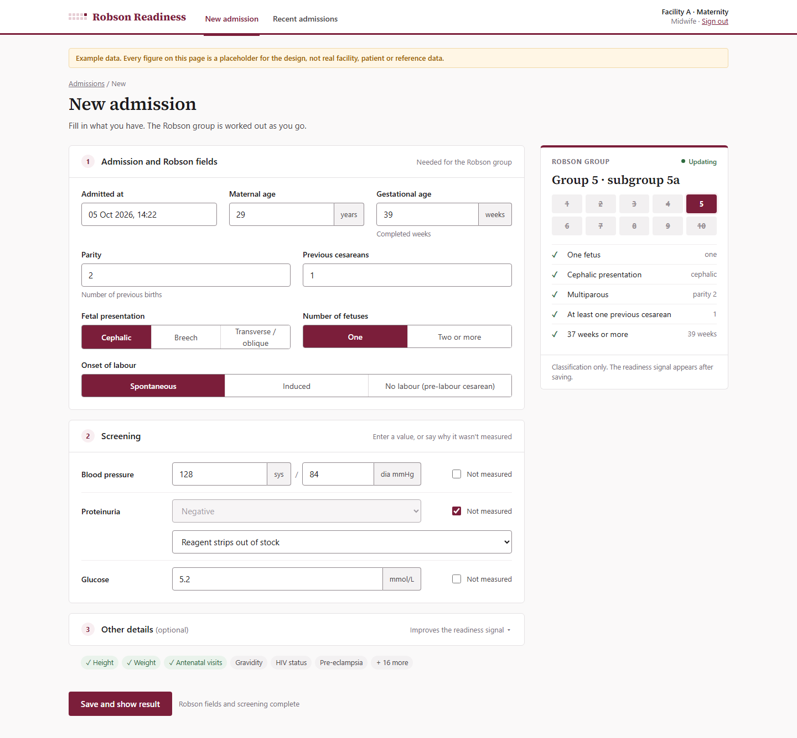
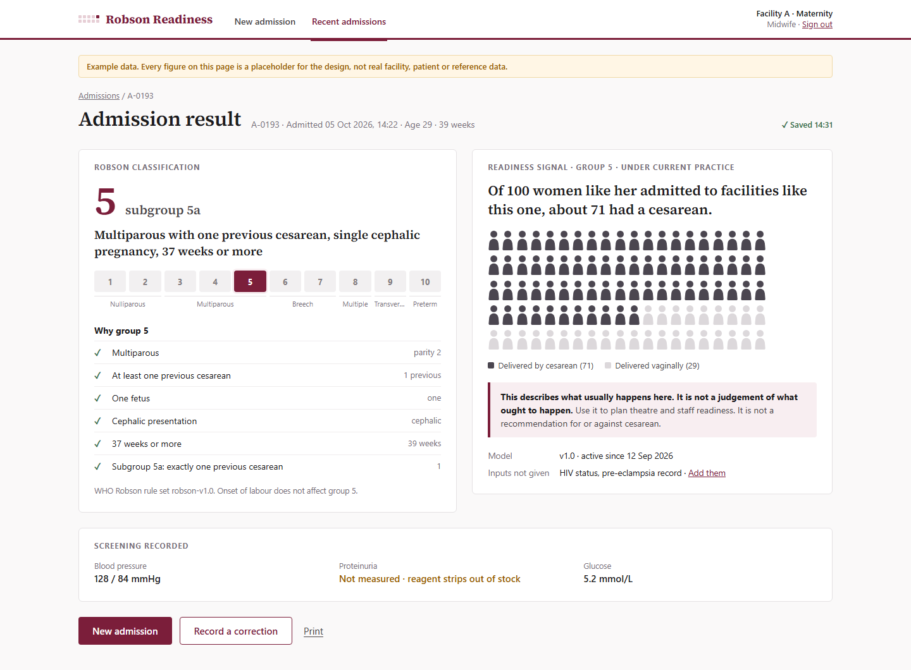
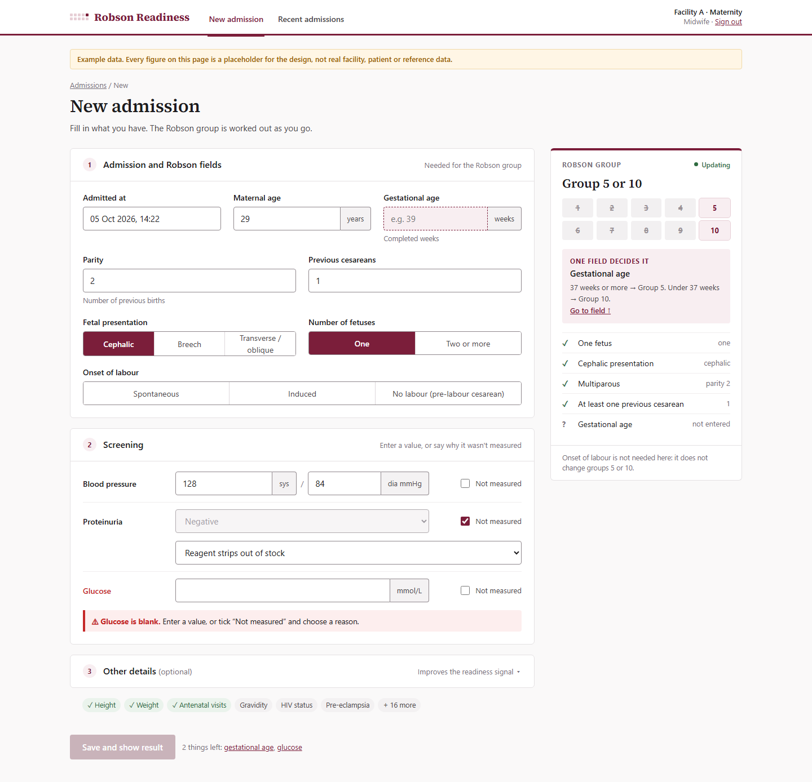
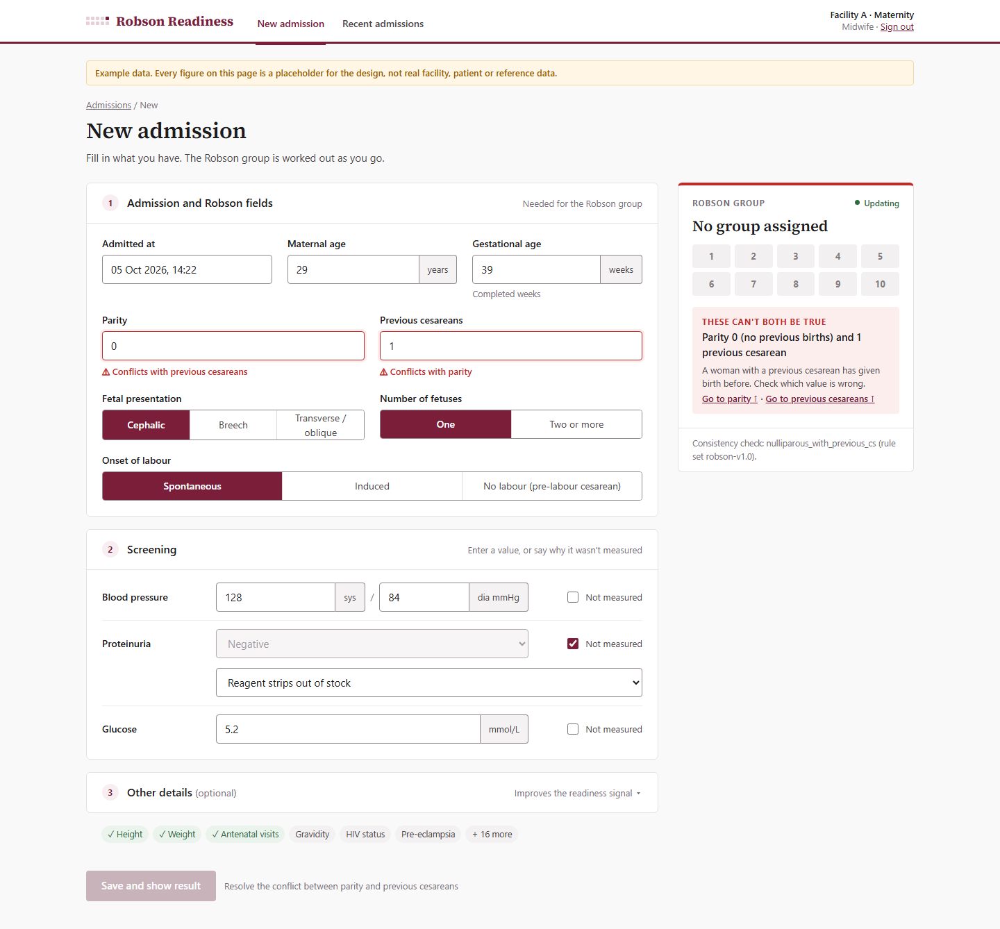
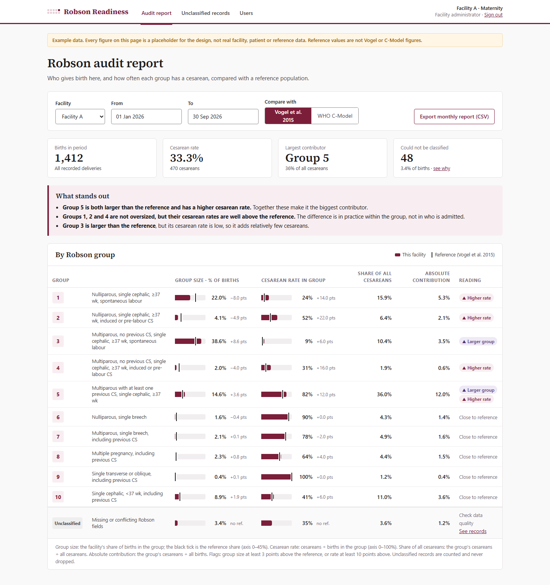
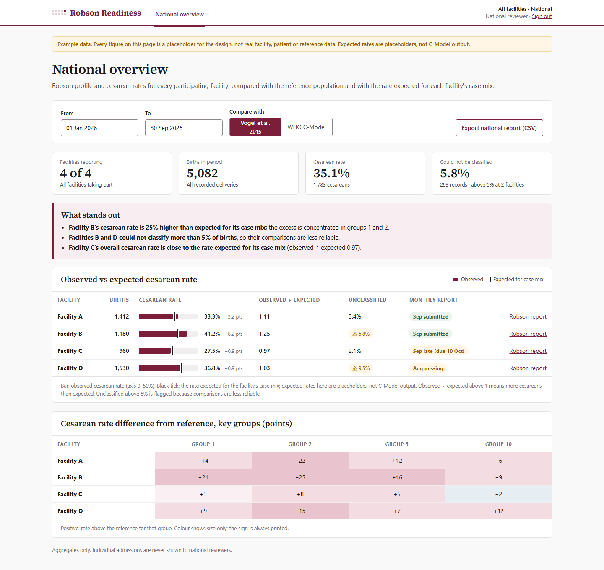
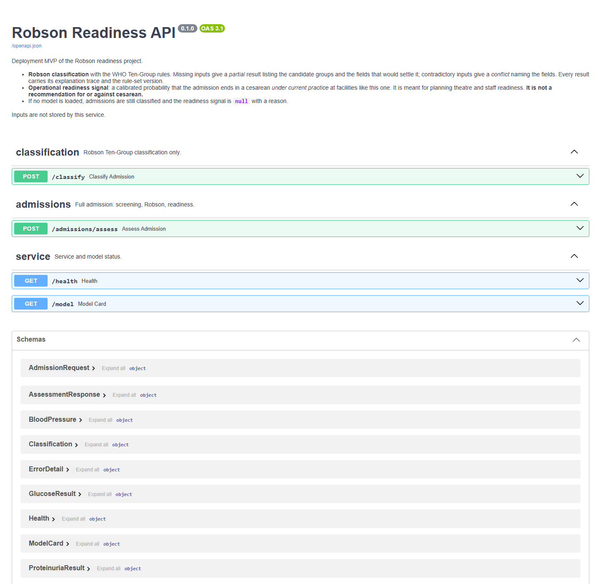
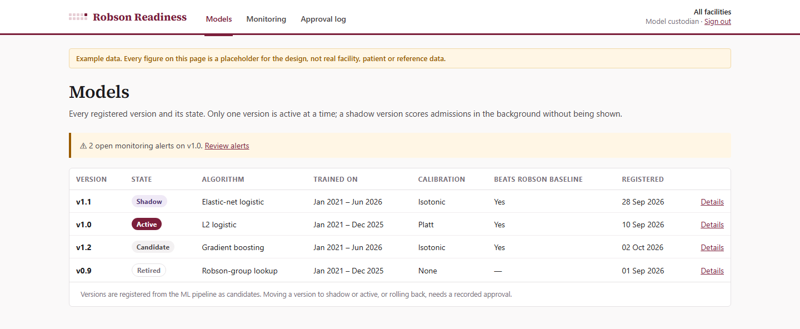
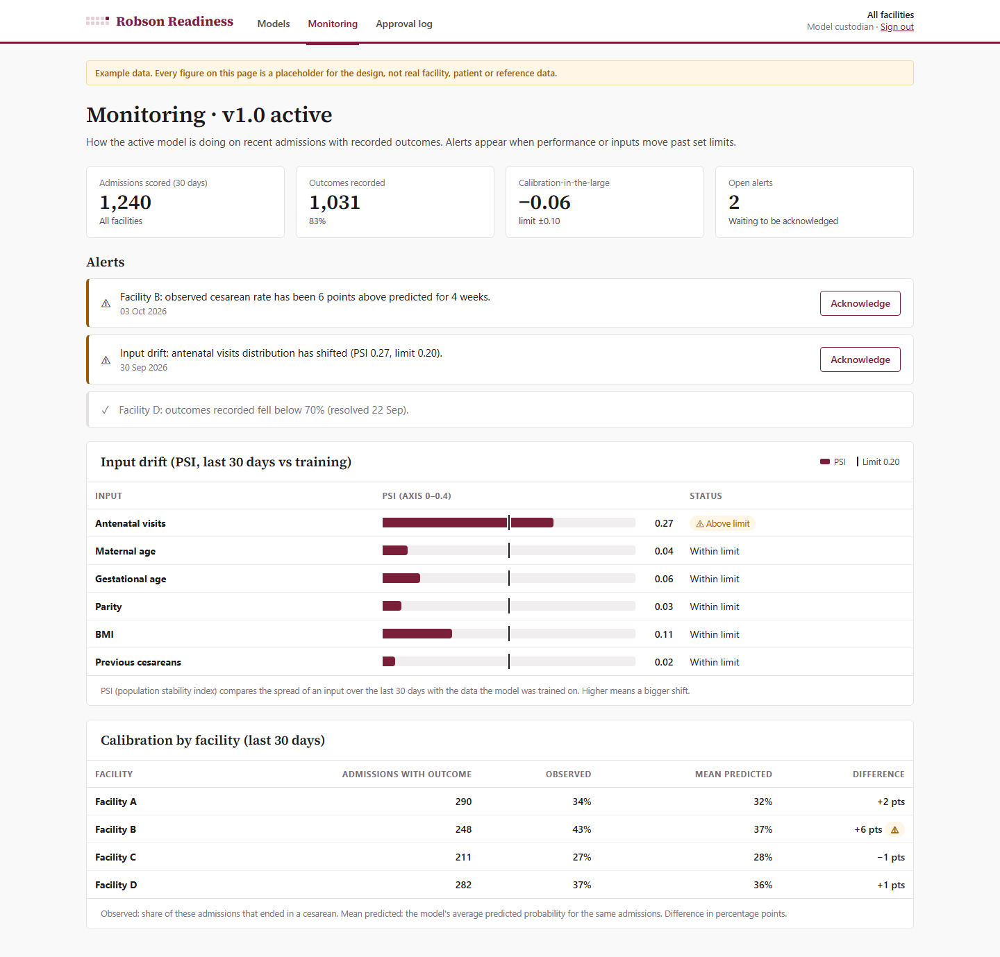

# Robson Readiness

**Automated Robson Ten-Group Classification and Cesarean Readiness System for Rwandan maternity units**

Repository: <https://github.com/icyeza/robby>
Video demo: <https://vimeo.com/1233169400>

## Description

At admission to a maternity ward, the system:

1. **Classifies** the woman into one of the WHO Robson Ten Groups automatically, from six admission
   fields (parity, previous cesareans, number of fetuses, presentation, gestational age, onset of
   labour). When fields are missing it lists the groups still possible and the field that would
   decide; when fields contradict each other it names them. Every result comes with the rules it
   checked.
2. **Enforces screening**: blood pressure, proteinuria and glucose must be entered, or a reason for
   not measuring them recorded.
3. **Estimates readiness**: a calibrated probability that the birth ends in a cesarean *under current
   practice*, an operational signal for theatre planning. It is never a recommendation for or
   against a cesarean.
4. **Audits facilities**: Robson group sizes, CS rates and contributions per facility, compared with
   reference populations and adjusted for case-mix.
5. **Bulk import from Excel**: a clinician can download a template, fill in one row per admission
   and upload it. Every row is checked with the same rules as the form; if any row fails, nothing is
   saved. If all rows pass, each one is classified and scored exactly like a form entry.
6. **Patient number and name (role-restricted)**: each admission records the hospital patient
   number and name. Clinicians at the facility see both, the facility administrator sees the number
   only, and no other role sees either.

The model was trained on 5,520 de-identified delivery records from four hospitals in and around Kigali
(Muhima, Masaka, Kibagabaga, La Croix du Sud; November 2023 to March 2024), shared under a data-sharing
agreement. The data are **not** in this repository.

### Results so far

| | |
|---|---|
| Robson classification | 94.4% of records resolve to exactly one group; no record is contradictory |
| Selected model | L2 logistic regression (feature set FS2, iterative imputation), chosen by a rule committed before training |
| Discrimination on an unseen hospital | mean AUC **0.752** (0.71-0.82 across the four hospitals), vs 0.730 for the Robson-group lookup alone |
| Calibration | slope **0.99** (target 0.8-1.2) |
| Later time period | AUC 0.772 (Robson lookup: 0.725) |
| Model families compared | 8, from a single decision tree to an FT-Transformer: all between 0.71 and 0.75 AUC |

## End-to-end system

From the hospital data to the clinician's screen and back. Source:
[`docs/diagrams/end-to-end.mmd`](docs/diagrams/end-to-end.mmd); image:
[`end-to-end.png`](docs/diagrams/end-to-end.png). The database is in
[`app/README.md`](app/README.md#data-model) (ERD), and how a single prediction is made is in
[`app/README.md`](app/README.md#how-a-prediction-is-made) (sequence diagram).

```mermaid
flowchart LR
    subgraph DATA["1. Data (ML/, offline)"]
        RAW["KoboToolbox xlsx export<br/>4 hospitals, data-sharing agreement<br/>never committed"]
        ING["robson-ml ingest + mapping<br/>canonical admissions, identifiers hashed"]
        ROB["robson-ml robson<br/>Robson classification (robson_engine)"]
        FEAT["features + leakage audit<br/>features_v1.yaml"]
        RAW --> ING --> ROB --> FEAT
    end

    subgraph TRAIN["2. Training and selection"]
        FIT["8 model families + baselines<br/>leave-one-hospital-out, later-period check"]
        SEL["pre-registered selection rule<br/>selection_rule.yaml"]
        MLF[("MLflow runs<br/>mlruns/")]
        FIT --> SEL
        FIT -.-> MLF
    end

    subgraph PACK["3. Packaging"]
        DEP["robson-ml fit-deploy<br/>deployment model"]
        PKG["robson-ml package<br/>manifest.json, model.joblib, feature_schema.json,<br/>reference_distributions.json, golden tests"]
        DEP --> PKG
    end

    subgraph REG["4. Registry (app, model custodian)"]
        CAND["robby-admin model register<br/>candidate"]
        SHAD["shadow<br/>scored, never shown"]
        ACT["active<br/>exactly one"]
        CAND -->|approval + reason| SHAD -->|approval + reason| ACT
    end

    subgraph USE["5. Clinical use (clinician)"]
        FORM["admission form<br/>or Excel import"]
        CLS["Robson group<br/>active rule set"]
        SCORE["readiness probability<br/>stored with its feature vector"]
        SHOW["result page<br/>group, explanation, signal"]
        FORM --> CLS --> SCORE --> SHOW
    end

    subgraph OUT["6. Outcomes"]
        DOUT["clinician records<br/>mode of delivery"]
        REC["reconcile job<br/>prediction joined to outcome"]
        DOUT --> REC
    end

    subgraph MON["7. Monitoring (model custodian)"]
        ALERT["calibration and input-drift alerts<br/>/monitoring"]
    end

    subgraph AUD["8. Audit"]
        FAC["facility report + CSV export<br/>facility admin"]
        NAT["national aggregates<br/>national reviewer"]
    end

    FHIR["Future: fetch admission from the<br/>hospital system, FHIR, by patient number"]

    FEAT --> FIT
    SEL --> DEP
    PKG --> CAND
    ACT --> SCORE
    SHOW --> DOUT
    REC --> ALERT
    ALERT -->|custodian retrains| FIT
    CLS --> FAC
    DOUT --> FAC
    FAC --> NAT
    FHIR -.-> FORM

    classDef future stroke-dasharray: 6 4,fill:#ffffff,color:#555555
    class FHIR future
```



1. **Data.** The KoboToolbox xlsx export from the four hospitals, shared under the data-sharing
   agreement, is read and mapped onto canonical admission fields by `robson-ml ingest` (identifiers
   hashed), classified into Robson groups with `robson_engine`, and turned into features with a
   leakage audit.
2. **Training and selection.** Eight model families plus baselines are trained and evaluated
   leave-one-hospital-out (and on a later time period), every run is logged to MLflow, and the model
   is chosen by a selection rule committed before training.
3. **Packaging.** `robson-ml fit-deploy` fits the chosen model and `robson-ml package` builds the
   artefact: manifest, model, feature schema, training distributions and golden test cases.
4. **Registry.** The app registers the artefact as a *candidate*; the model custodian moves it to
   *shadow* (scored, never shown) and then *active*, each step with a named approver and a reason.
5. **Clinical use.** An admission from the form or from an Excel import is classified with the
   active rule set and scored by the active model; the result page shows the group, its explanation
   and the readiness signal.
6. **Outcomes.** The clinician records the mode of delivery, and a background job joins every
   prediction to the outcome of its admission.
7. **Monitoring.** Calibration per facility and input drift against the training distributions
   raise alerts for the model custodian, who retrains when needed, which closes the loop back to
   training.
8. **Audit.** The facility administrator gets the Robson report and CSV export for the facility;
   the national reviewer sees aggregates across facilities.

*Future (dashed):* fetching the admission from the hospital system (FHIR, by patient number)
instead of typing it in.

### Who sees what

| Role | Patient data visible |
|---|---|
| Clinician | Patient name and number, for admissions at their own facility |
| Facility administrator | Patient number only (no name), for their own facility |
| National reviewer | Aggregates only, no individual admissions |
| Model custodian | No patient data (model metrics, monitoring and drift only) |
| System administrator | No patient data (users and facilities only) |

## Repository layout

| Folder | Contents |
|---|---|
| [`ML/`](ML/) | Notebooks, ML code, tests and the API. **Start with [`ML/README.md`](ML/README.md)** |
| [`ML/notebooks/`](ML/notebooks/) | `01_eda` (data quality, Robson classification, exploratory analysis), `02_model_training` (architectures, training, hyperparameter tuning, MLflow tracking, per-model metrics and confusion matrices, selection), `03_model_evaluation` (interpretation, robustness, deployment, missing data) and `04_audit_and_research_questions` (Robson audit, case-mix, missing data) |
| [`ML/api/`](ML/api/) | FastAPI service: Robson classification and readiness probability, with Swagger UI |
| [`ML/packages/`](ML/packages/) | `robson_engine` (the versioned Robson rule engine) and `robson_serving` (model loading, calibration, drift and monitoring), shared by the ML code and the app |
| [`app/`](app/) | The web application: admission form, Excel and OpenClinic import, results, outcomes, audit and national reports, model registry, monitoring, users. FastAPI + Jinja2 + htmx over PostgreSQL. **Details in [`app/README.md`](app/README.md)** |
| [`docs/diagrams/`](docs/diagrams/) | End-to-end, ERD and prediction-sequence diagrams (Mermaid source and PNG) |
| [`ui-mockups/`](ui-mockups/) | Clickable HTML mockups of every screen of the web app, and their [screenshots](ui-mockups/screenshots/) |

## Setup

Prerequisites: [Git](https://git-scm.com/), [uv](https://docs.astral.sh/uv/getting-started/installation/)
(it installs Python 3.11 itself) and a web browser.

```bash
git clone https://github.com/icyeza/robby.git
cd robby/ML
uv sync                       # creates .venv with every dependency pinned in uv.lock
uv run pytest                 # test suite (runs on synthetic data)
```

**Notebooks.** Open `ML/notebooks/*.ipynb` in Jupyter (`uv run jupyter lab notebooks/`) or VS Code
using the `ML/.venv` interpreter. The committed copies already contain the real-data outputs. Without
the private dataset, re-running them uses synthetic data automatically.

**API.** From `ML/`:

```bash
uv run uvicorn api.main:app --reload
# open http://127.0.0.1:8000/docs  (Swagger UI)
```

Endpoints: `GET /health`, `GET /model`, `POST /classify` (Robson group with explanation),
`POST /admissions/assess` (screening check + Robson group + readiness probability). Details and an
example are in [`ML/README.md`](ML/README.md#serving-the-model-api).

The trained model (`ML/artefacts/readiness-v1.0/`) is not in the repository, because it was fitted on
the private data. `uv run python scripts/build_demo_model.py` builds a stand-in model from synthetic
data in about a minute; start the API with `ROBSON_MODEL_DIR=artefacts/demo-synthetic`. Without any
model the API still classifies admissions and reports that the readiness estimate is unavailable,
the same graceful degradation the app is designed for.

**Web app.** Needs PostgreSQL 16 as well. Full instructions (Windows and Linux, settings, demo
mode, tests) are in [`app/README.md`](app/README.md#development-on-windows-git-bash). In short:

```bash
cd robby/app
cp .env.example .env          # set ROBBY_DATABASE_URL, ROBBY_SECRET_KEY, ROBBY_SECURE_COOKIES=false
uv sync
uv run robby-admin db upgrade
uv run robby-admin rules load
uv run robby-admin create-system-admin --username admin
uv run uvicorn robby.main:create_app --factory --reload
# open http://127.0.0.1:8000
```

For a ready-filled example (4 demo hospitals, about 700 admissions, every role), run
`uv run robby-admin demo load` and then `sh scripts/demo.sh` (http://127.0.0.1:8100; demo
accounts and password in [`app/README.md`](app/README.md#demo-mode)).

**UI mockups.** Open `ui-mockups/index.html` in a browser. No server or build step is needed.

## Designs

* Figma: <https://www.figma.com/design/pjOYnAzRpyY2UjmONP0gTZ/Robby>
* Clickable mockups: [`ui-mockups/index.html`](ui-mockups/index.html), 23 screens covering every role
  and the error states.

| Admission form with live Robson group | Result: group, explanation and readiness signal |
|---|---|
|  |  |
| **Incomplete inputs: the field that decides** | **Contradictory inputs** |
|  |  |
| **Facility audit report** | **National overview** |
|  |  |
| **API (Swagger UI): the deployed MVP** | |
|  | |
| **Model registry** | **Model monitoring** |
|  |  |

Every screen:

| Area | Screens |
|---|---|
| Everyone | [Sign in](ui-mockups/screenshots/login.png) ([phone](ui-mockups/screenshots/login-mobile.png)), [session ended](ui-mockups/screenshots/session-expired.png) |
| Clinician | [new admission](ui-mockups/screenshots/admission-new.png), [incomplete](ui-mockups/screenshots/admission-incomplete.png), [conflict](ui-mockups/screenshots/admission-conflict.png), [result](ui-mockups/screenshots/result.png) ([phone](ui-mockups/screenshots/result-mobile.png)), [result without a model](ui-mockups/screenshots/result-no-model.png), [recent admissions](ui-mockups/screenshots/admissions-recent.png), [record outcome](ui-mockups/screenshots/outcome-record.png), [correction](ui-mockups/screenshots/correction.png), [corrected result](ui-mockups/screenshots/result-corrected.png), [connection lost](ui-mockups/screenshots/connection-lost.png) |
| Facility administrator / model custodian | [audit report](ui-mockups/screenshots/audit-report.png), [unclassified records](ui-mockups/screenshots/unclassified.png), [users](ui-mockups/screenshots/users.png), [models](ui-mockups/screenshots/models.png), [model detail](ui-mockups/screenshots/model-detail.png), [monitoring](ui-mockups/screenshots/monitoring.png), [approval log](ui-mockups/screenshots/audit-log.png) |
| National | [overview](ui-mockups/screenshots/national-overview.png), [facility report](ui-mockups/screenshots/national-facility.png), [facilities](ui-mockups/screenshots/facilities.png) |

## Testing, performance and compatibility

### Automated tests

About 820 test functions in three suites, all on synthetic data (the real records never enter a test):

| Suite | Run | What it covers |
|---|---|---|
| [`ML/tests/`](ML/tests/) | `cd ML && uv run pytest` | Ingest and mapping, Robson classification of the dataset, leakage screens, splits (no mother on both sides), every model family, calibration, metrics, selection rule, packaging, privacy (small-cell suppression), notebooks (including a scan of committed outputs for patient data), the API |
| [`ML/packages/*/tests/`](ML/packages/) | `uv run pytest` in each package | Rule engine (every group, partial and conflict cases, rule-set checksum), serving: features, calibration, drift, monitoring, golden-output contract |
| [`app/tests/`](app/tests/) | `cd app && uv run pytest` (needs PostgreSQL) | Migrations and database triggers (clinical rows cannot be edited), the access matrix of every role on every page, CSRF, sessions and lockout, the clinical flow, Excel and API import (all or nothing), audit arithmetic against hand-computed values, model governance, reconciliation, monitoring, no inline script or style in any page |

Model validation is separate from the code tests: leave-one-hospital-out (each hospital is scored
by a model that never saw it) and a later-period check, reported in [`ML/README.md`](ML/README.md).

### Edge cases and performance

[`ML/scripts/benchmark.py`](ML/scripts/benchmark.py) (`cd ML && uv run python scripts/benchmark.py`), on
a Windows 11 laptop (AMD Ryzen, Python 3.11), with generated inputs:

* **Exhaustive engine sweep.** All 14,400 combinations of the six Robson inputs, each including
  "not recorded" and the edges of its domain: 8,129 resolved, 4,543 partial, 1,728 conflict, no
  exceptions. Every one of the 2,340 complete, non-contradictory combinations resolves to exactly
  one group. About 6,400 classifications per second.
* **API latency**, 2,000 requests per endpoint, in-process and sequential, with the `readiness-v1.0`
  model; a fifth of the admissions have missing fields and a tenth have screening left blank:

  | Endpoint | p50 | p95 | p99 | max |
  |---|---|---|---|---|
  | `POST /classify` | 2.7 ms | 3.5 ms | 3.9 ms | 5.1 ms |
  | `POST /admissions/assess` (screening + Robson + model) | 88 ms | 98 ms | 105 ms | 165 ms |

  All 204 admissions with blank screening were rejected with 422, and none of the valid ones were.
  Most of the assessment time is the model's iterative imputation; it stays far below what a
  clinician notices at the bedside. Cold start (rule set and model load): 2.9 s.

### Browsers and devices

[`app/scripts/browser_check.py`](app/scripts/browser_check.py) drives the real app (demo instance)
through the clinician flow with Playwright: sign in, fill the form, check the live Robson panel,
check that saving is blocked while screening is blank, save, and check the result page. It fails on
any console error or Content-Security-Policy violation from the app's own pages.

| Browser | Desktop 1366x768 | Phone 390x844 | Form load |
|---|---|---|---|
| Chrome 156 | pass | pass | 75 ms |
| Edge 156 | pass | pass | 80 ms |
| Firefox 157 | pass | pass | 150-190 ms |
| WebKit 27.2 (Safari's engine) | pass | pass | 65-70 ms |

Found and fixed along the way: pages had no favicon, so every browser requested a missing
`/favicon.ico` (a 404 in the console). Known and harmless: WebKit reports its *own* built-in
`<select>` styling as refused by the strict CSP (a bare page with only a `<select>` does the same);
the app's styles apply normally. Screenshots:
[WebKit on a phone](docs/testing/result-webkit-phone.png),
[Firefox on a desktop](docs/testing/result-firefox-desktop.png).

### Python versions

The shared packages (`robson_engine`, `robson_serving`) pass their tests on Python 3.11, 3.12 and
3.13 (130 and 106 tests). The ML workspace is pinned to 3.11 for reproducible training.

## Scope against the proposal

The proposal (Section 1.5) commits four components at *deployed* level and four at *demonstrated*
level, and says that any reduction is reported rather than silently dropped. Where each one stands:

| Proposal item | Level committed | Delivered | Notes |
|---|---|---|---|
| Versioned Robson classification engine | Deployed | Yes | [`ML/packages/robson_engine`](ML/packages/robson_engine/); 94.4% of the 5,520 records resolve to one group, none to more than one |
| Admission form with enforced screening | Deployed | Yes | Saving is blocked until each screening field has a value or a recorded reason, in the form, the Excel import, the automated import and the API |
| Audit service against external reference distributions | Deployed | Yes | Facility and national reports in the app; an independent offline implementation ([`audit_offline.py`](ML/src/robson_ml/audit_offline.py)) for the agreement check |
| Calibrated admission-time model comparing logistic regression, gradient boosting and a tabular deep-learning baseline | Deployed | Yes | All three compared (XGBoost and an FT-Transformer among them); the selected L2 logistic regression is calibrated, registered, and served through the API and the app, with the model version stored on every prediction |
| Full algorithm comparison (stretch: seven algorithms) | Demonstrated | Exceeded | Eight families plus four baselines, chosen by the pre-registered rule |
| Reconciliation and monitoring loop | Demonstrated | Yes | Outcome reconciliation, calibration and drift alerts; exercised on the synthetic demo database, since there is no prospective volume yet |
| FHIR interoperability layer | Demonstrated | **Not evaluated** | No hospital FHIR endpoint was available. Getting admissions out of the hospital system is covered instead by a token-authenticated import API, tested against an OpenClinic stand-in ([`app/scripts/openclinic_standin/`](app/scripts/openclinic_standin/)), and by Excel import; both use the same checks as the form. The FHIR adapter is the next piece of work |
| Live pilot in a partner maternity unit | Demonstrated | **Reduced to a demonstration instance** | Ethics clearance has not arrived, so, as the proposal provides, the system runs on a demonstration instance with synthetic and de-identified data and is not installed in a ward. Server deployment files (systemd, nginx, TLS) are not written yet |
| Clinician usability sessions (at least 7 of 8 testers complete an entry unaided; RQ4 bedside time) | Evaluation | **Not yet run** | Planned on the demonstration instance; RQ4 is unanswered until they happen |

Out of scope as planned: a wearable or physiological screening layer, and computer-vision extraction
from antenatal cards or partographs.

One deliberate change of framing: the proposal's title speaks of risk prediction to *support
cesarean decision-making*, but the same proposal rules out any individual recommendation. The
system therefore presents the probability as a *readiness signal under current practice*, for
planning theatre and staff, and every screen that shows it says that it is not a recommendation.

## Deployment plan

**Target:** one partner maternity unit first (a pilot), on hardware the hospital already has, with
intermittent power and no dedicated systems administrator. It needs ethics clearance; until then it
runs as a demonstration instance on de-identified records.

**Architecture:** a single Python application.

```
browser (clinician, administrator) ──HTTPS──> nginx (reverse proxy, TLS)
                                                │
                                                ▼
                             Uvicorn workers under systemd: FastAPI app
                             ├── Robson rule engine (versioned rule set)
                             ├── readiness model (joblib, loaded in-process)
                             └── audit service
                                                │
                                                ▼
                                   PostgreSQL (encrypted, append-only records)
```

* **One service, no containers.** Installing or recovering it means updating one virtual environment
  (`uv sync`) and restarting one systemd unit, which a hospital IT officer can do.
* **The model runs inside the API process.** The calibrated scikit-learn pipeline is loaded with
  joblib, so there is no separate inference service to keep alive.
* **Model lifecycle.** A new model is trained offline with `robson-ml fit-deploy`, registered as a
  *candidate*, run in *shadow* (scored but not shown), and promoted to *active* only through a recorded
  approval. Exactly one model is active, and every prediction stores the model and rule-set versions
  that produced it.
* **Monitoring.** Predictions are matched to delivery outcomes once recorded, and discrimination and
  calibration are tracked on a rolling window per facility and Robson group (the monitoring screen).
* **Graceful degradation.** If the model is unavailable, the Robson classification still works. If
  the network drops, the form keeps what was entered.
* **Security.** HTTPS with token authentication, role-based access (clinician, facility
  administrator, model custodian, national), and no identifiable data leaving the facility.

**Steps:**

| Step | What | Status |
|---|---|---|
| 1 | Train, evaluate and select the model; freeze `readiness-v1.0` | Done |
| 2 | Robson engine as a tested package (`ML/packages/robson_engine`) | Done |
| 3 | API exposing classification and readiness (`ML/api`) | Done (MVP) |
| 4 | UI design (Figma and HTML mockups) | Done |
| 5 | Web app: server-rendered pages (Jinja2 + htmx), PostgreSQL storage, sign-in, Excel and OpenClinic import, audit, model registry, monitoring ([`app/`](app/)) | Done (runs as a demonstration instance) |
| 6 | Install on a server at the partner facility (nginx + systemd), usability sessions with clinicians | After ethics clearance |
